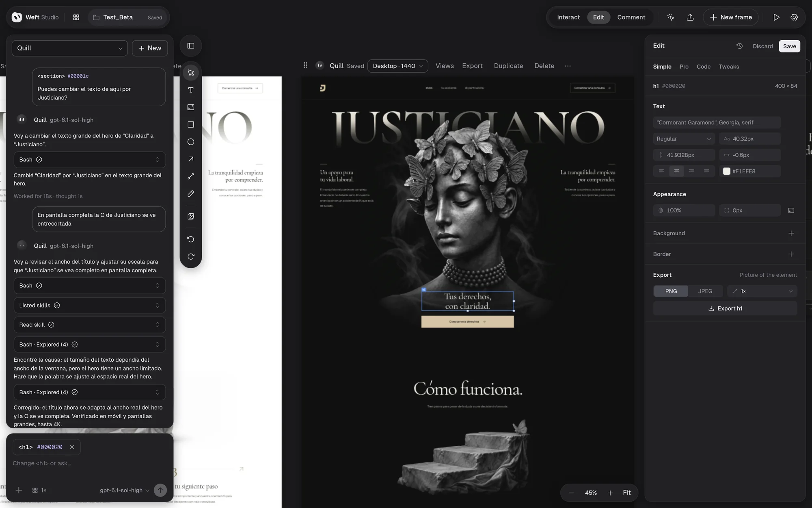
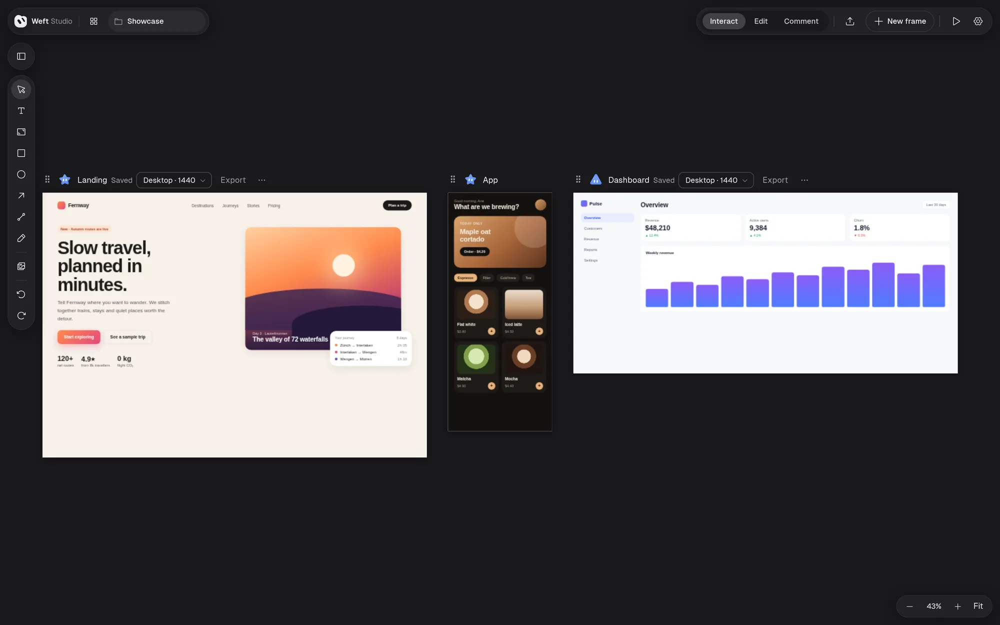

  

<h1 align="center">Weft Studio</h1>

<b>Design interfaces with your AI agent, on a live canvas.</b> 
A desktop app for Linux and Windows that works with Claude Code, Codex, OpenCode and Antigravity.

  <b>English</b> ·
  <a href="README.es.md">Español</a> ·
  <a href="README.pt-BR.md">Português</a> ·
  <a href="README.fr.md">Français</a> ·
  <a href="README.de.md">Deutsch</a> ·
  <a href="README.zh-CN.md">简体中文</a> ·
  <a href="README.ja.md">日本語</a>

  
  
  
  
  

  <a href="https://willi005.github.io/weft-studio-releases/"><b>Website</b></a> ·
  <a href="https://github.com/Willi005/weft-studio-releases/releases"><b>Download</b></a>

**Weft Studio** (formerly CodeWeaves Studio) is a design tool where you and an AI coding agent work on the same canvas. Describe a screen, watch the agent draw it, then move, restyle and rewrite it by hand. Each design is a frame saved as a readable HTML file (`design.ws.html`) and has its own agent: **Claude Code, Codex, OpenCode or Antigravity**. What you change and what the agent writes both show up instantly.

This repository publishes the installers; the source code is not here.

## What you can do

- **Design with agents:** describe what you want and try 1, 2 or 3 directions in parallel, each with its own agent, model and effort level. The agent can ask you questions first, read other frames you mention and use images you attach.
- **Edit by hand, live:** select, move and resize; text and styles in the inspector (Simple, Pro, Code and Tweaks); layers, drawing tools, undo and redo. Every change saves itself and each design has its own version history.
- **Multi-screen apps:** a design can declare its views (home, pricing, contact…) and the canvas shows one frame per view of the same document.
- **Your own files:** the **Assets** panel uploads images, GIFs and videos to a design. The agent knows they exist and uses them.
- **Comment and present:** comments pinned to elements, and **Present** full screen, interactive and live.
- **Export and import:** readable HTML with its runtime that opens in any browser; a ZIP with the design, runtime and assets; PNG and JPEG. **Import** opens those files again, as well as Claude Design `.dc.html` files.
- **Hand the design to your code:** "Send to a coding agent…" copies a prompt so Claude Code, Codex, Gemini CLI or OpenCode read the design through a read-only **MCP** server and build it into your project.
- **Projects:** a home screen with covers, renaming and trash.

## Install

Download the latest version from [Releases](https://github.com/Willi005/weft-studio-releases/releases).

| System | File | How |
| --- | --- | --- |
| Linux x86_64 | `Weft-Studio-<version>-x86_64.AppImage` | `chmod +x` and open it; the first run adds it to your applications menu |
| Debian / Ubuntu | `weft-studio_<version>_amd64.deb` | `sudo apt install ./weft-studio_<version>_amd64.deb` (also installs git) |
| Windows 11 x64 | `Weft-Studio-<version>-x64-Setup.exe` | Run it; it installs for your user, without admin rights |

**Requirements:**
- **git** (on Windows, [Git for Windows](https://git-scm.com/download/win)).
- At least one agent with its account. The welcome screen and **Settings → Providers** find the ones you have, offer to install the missing ones with their official installer (showing the command first) and sign you in. Models from other providers are available through OpenCode.
- Node.js is not needed, except to install OpenCode on Windows (it uses npm).

**The Windows installer is not code-signed yet**, so Windows may warn about an unknown publisher. To check any download, compare its checksum with the one in the release's `SHA256SUMS.txt`:
- Linux: `sha256sum <file>`
- Windows (PowerShell): `Get-FileHash <file>`

When you uninstall on Windows, the uninstaller asks separately whether to delete settings and cache and whether to delete your project folders. "No" is the default for both.

## Updates

The app checks this repository for new versions when it opens and every six hours, and tells you what is new. It only downloads and installs when you ask: **Update** downloads, **Restart to update** installs and reopens the app, and **Settings → Updates** checks right away. The AppImage, the `.deb` and the Windows installer all update from inside the app.

**Coming from CodeWeaves Studio?** It updates itself to Weft Studio and keeps your projects, accounts and settings. Up to 0.2.0-beta.6 the files were called `CodeWeaves-Studio-<version>-x86_64.AppImage`, `codeweaves-studio_<version>_amd64.deb` and `CodeWeaves-Studio-<version>-x64-Setup.exe`; each release still carries copies under those names for old installs.

## Status

Weft Studio is in **beta** (`0.2.0-beta.N`) and every version is published as a prerelease. What changed in each one is in its [release notes](https://github.com/Willi005/weft-studio-releases/releases).

If you like the project, a ⭐ helps other people find it.
